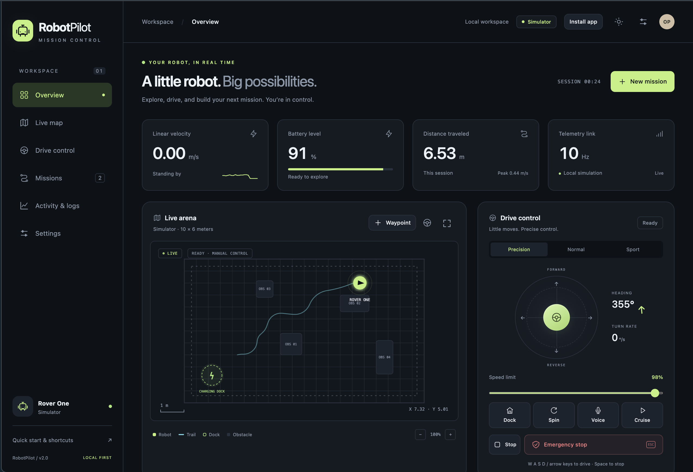
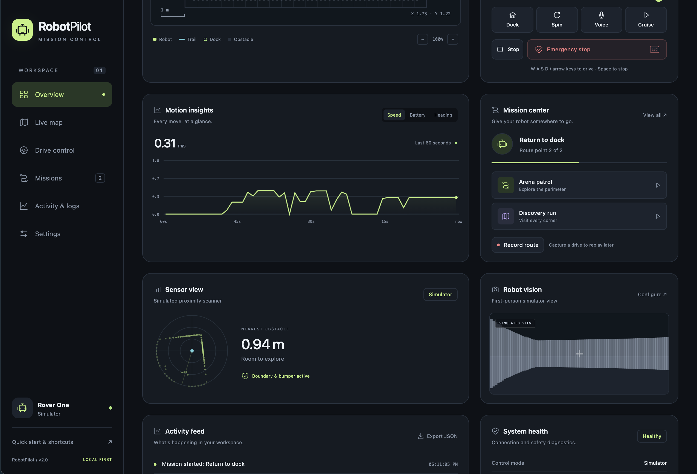
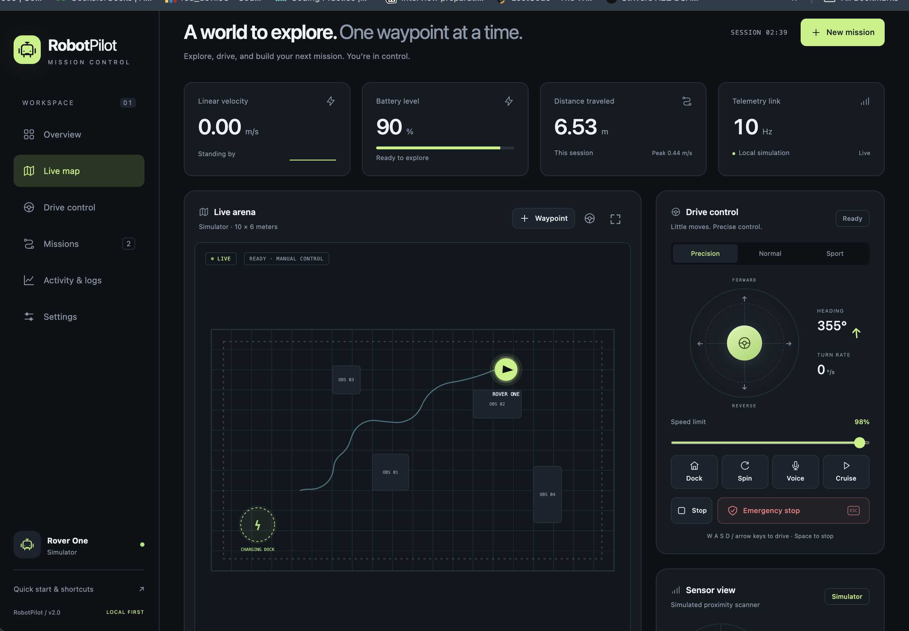
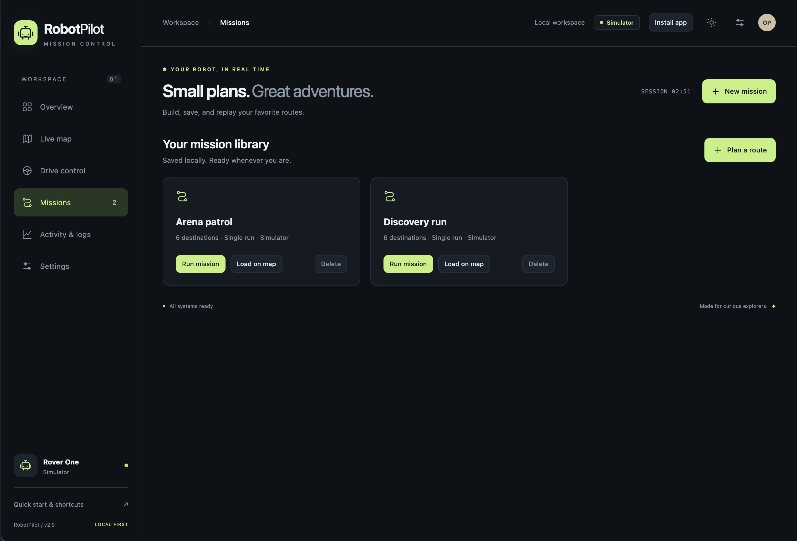
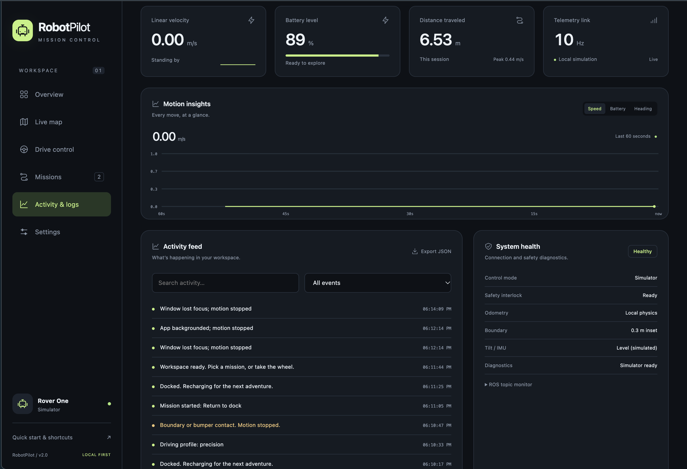
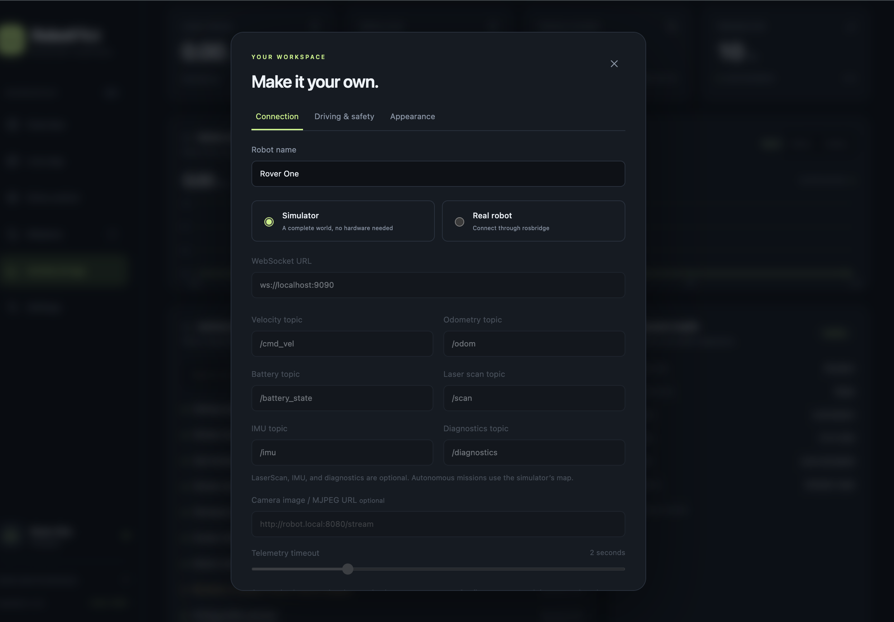

# RobotPilot · Mission Control

An installable web app (PWA) for driving a mobile robot from a phone or laptop. It includes a built-in arena simulator, so it works as a live demo with no hardware, and a rosbridge mode for a real robot.

No build step and no runtime dependencies: plain HTML, CSS, JavaScript, and canvas.

## What it does

- Responsive mission-control dashboard with desktop sidebar and mobile navigation.
- Midnight, daylight, and system themes, onboarding, notifications, and reduced-motion support.
- Touch joystick, keyboard driving, bounded voice commands, and Precision / Normal / Sport profiles.
- Speed and acceleration limits; simulator cruise control and proximity braking.
- Latched emergency stop with a deliberate release dialog; Space stops all motion.
- Animated arena map, zoom, robot-follow view, trail, boundary, and optional sensor rays.
- Tap-to-plan waypoints, obstacle-aware A* routes, patrol and exploration presets, looping missions, docking, and local mission library.
- Record a simulator drive, save its destinations, and replay through the route planner.
- Live speed, turn rate, heading, position, battery, data rate, distance, and peak speed.
- Speed, battery, and heading charts covering the last 60 seconds.
- Simulator proximity scanner and raycast first-person view, both clearly labeled as simulated.
- Configurable real-robot odometry, battery, LaserScan, IMU, diagnostics, and HTTP(S) image/MJPEG camera streams.
- Searchable activity feed, JSON export, session history, and telemetry CSV export.
- Offline PWA installation and local persistence without an account.

## Screenshots

The six screenshots below are stored in `screenshots/`. Each caption explains the screen shown. Click an image to view it at full size.

| Main Dashboard & Drive Control | Motion Insights & Active Mission | Live Arena Map |
|:---:|:---:|:---:|
| <a href="./screenshots/mainpage.png"></a> | <a href="./screenshots/overview.png"></a> | <a href="./screenshots/missionmap.png"></a> |
| Monitor live telemetry and drive with the joystick, speed limit, Dock, Spin, Voice, Cruise, Stop, and emergency-stop controls. | Follow the last 60 seconds of speed history and an active docking mission, alongside obstacle clearance and the simulated first-person view. | Inspect the robot’s position and traveled path in the arena. The map also provides waypoint, follow, fullscreen, and zoom controls. |
| **Mission Library** | **Activity & System Health** | **Workspace & Connection Settings** |
| <a href="./screenshots/missionoverview.png"></a> | <a href="./screenshots/missionlogs.png"></a> | <a href="./screenshots/makeyourOwnMission.png"></a> |
| Run saved Arena patrol and Discovery run missions, load their destinations on the map, delete routes, or start planning a new mission. | Search and filter timestamped events, export them as JSON, and review connection, safety interlock, odometry, boundary, IMU, and diagnostic status. | Customize the robot name and connection mode. Configure rosbridge, ROS topics, an optional camera feed, and the telemetry timeout for a real robot. |

The camera and scanner screenshots show simulated views. Real-robot feeds appear when supported hardware is connected and configured.

`makeyourOwnMission.png` shows the **Settings → Connection** dialog, despite its filename. Custom missions are planned through **New mission** or **Plan a route** on the map.

## Installation & Running

1. Download or clone this folder. There are no dependencies to install.
2. Start the local server:

```bash
python3 -m http.server 8080
```

Open http://localhost:8080. Service workers and microphone access need `localhost` or HTTPS.

If you have Node.js, `npm start` runs the same server. Node is only needed for the verification scripts; Python is sufficient to run the app. This is a browser PWA, so Expo Go and Android/iOS build tools are not required.

3. Choose a preset mission, use the joystick, or click New mission to create a route.
4. Optionally install it using the browser’s Install app action, or Share → Add to Home Screen on iPhone.

## Tech Stack

- HTML and CSS with responsive layouts and dark/light themes
- Native JavaScript ES modules, without a framework or bundler
- Canvas 2D for the live map, charts, sensor scanner, and simulated camera
- WebSocket rosbridge transport for ROS telemetry and velocity commands
- Web Speech API for voice control where supported
- Service worker, web app manifest, and localStorage for installation, offline use, and saved data
- Node’s built-in test runner; optional Playwright browser verification

## Deploy to GitHub Pages

1. Create a repository and push this folder to the `main` branch.
2. In the repository, open Settings, then Pages, and set Source to GitHub Actions.
3. The workflow in `.github/workflows/deploy.yml` publishes on every push. The site appears at `https://<user>.github.io/<repo>/`.

All paths are relative, so it works under a repository subpath.

## Connect a real robot (ROS)

On the robot or a computer on the same network:

```bash
# ROS 2
ros2 launch rosbridge_server rosbridge_websocket_launch.xml
```

In Settings → Connection, choose Real robot and enter `ws://<robot-ip>:9090`. Topic names are editable; optional sensor topics can be blank. After odometry arrives, release the emergency stop to enable driving.

Notes:

- A page served over HTTPS cannot open a plain `ws://` connection to another machine. Either use a `wss://` address (for example through a tunnel or a reverse proxy with TLS), or serve this app over plain HTTP on the local network.
- Velocity publishes at 10 Hz, including an idle zero-velocity heartbeat. Input release, emergency stop, focus loss, backgrounding, and opening Settings send an immediate zero command.
- Connection loss or stale odometry locks controls. Reconnecting never resumes movement; fresh odometry and an explicit stop release are required.
- The browser cannot deliver a stop command over a broken connection. Configure a robot-side `cmd_vel` timeout; this app is not a replacement for a physical emergency stop.
- Fresh IMU data reporting tilt of at least 30°, or ROS diagnostic error/stale status, latches the emergency stop.
- Battery uses the standard ROS fraction from 0 to 1. Missing or stale battery and sensor readings display as unavailable.
- Autonomous navigation, geofencing, docking, route replay, and cruise are simulator features. Real-robot autonomy needs a robot-side navigation system and map integration.
- Optional camera input supports image/MJPEG URLs, not RTSP or WebRTC. Browser network and mixed-content restrictions still apply.

## Simulator missions and safety

Click New mission, tap clear destinations on the map, then choose Save or Run route. The planner routes around walls and obstacles. Manual input takes over from a mission; Stop cancels it. Missions stop if progress stalls, and a looping mission replans after each completed circuit.

Record route captures positions while you drive. Stopping the recording opens the save dialog. Replay navigates through those positions; it does not replay raw motor commands or exact timing.

Settings → Driving & safety controls acceleration, boundary inset, automatic docking at 15% battery, and proximity braking. At 5% battery, manual driving locks; docking remains available while power remains. Reset simulator restores the rover and battery without deleting saved missions.

## Data and verification

Configuration, up to 50 missions, the latest 250 events, and 30 session summaries are stored in this browser. Clearing site data removes them. Session telemetry is kept in memory for CSV export (up to one hour); charts show the most recent minute. Data is not synchronized between devices.

```bash
npm run check
npm test
```

The tests cover obstacle clearance, boundary enforcement, multi-destination planning, raycasting, malformed telemetry, saved mission validation, and connection settings. No package installation is needed for these checks.

An optional browser suite in `tests/browser.test.js` uses an installed Playwright package and Chrome. Run it with `node tests/browser.test.js` when Playwright is resolvable, or set `PLAYWRIGHT_MODULE` to its module entry point. It verifies navigation, driving, emergency stop, docking, full patrol, route persistence, recording, exports, mobile layouts, a mocked robot transport, and offline reload.

To update this gallery, replace the images in `screenshots/`. If filenames change, update the links in the Screenshots section. The optional `npm run screenshots` command uses Playwright to generate separate reference captures in `assets/screenshots/`.

## Project Structure

```text
robot-pilot/
├── index.html                 # Dashboard, navigation, and dialogs
├── styles.css                 # Themes, responsive layouts, and animations
├── app.js                     # UI, controls, physics, transport, and persistence
├── core.js                    # Geometry, A* routing, and telemetry validation
├── sw.js                      # Offline cache and app updates
├── manifest.webmanifest       # PWA installation metadata
├── package.json               # Run, verification, and screenshot commands
├── icons/                     # App and home-screen icons
├── screenshots/               # Latest screenshots displayed in this README
├── assets/
│   └── screenshots/           # Generated reference captures
├── tests/
│   ├── core.test.js           # Geometry and validation tests
│   └── browser.test.js        # Browser checks and screenshot capture
└── .github/workflows/
    └── deploy.yml             # GitHub Pages publishing
```

## Files

| File | Purpose |
| --- | --- |
| `index.html`, `styles.css`, `app.js` | The app |
| `core.js` | Pure geometry, path planning, and input validation |
| `tests/` | Core tests and optional browser verification |
| `screenshots/` | Latest app screenshot gallery |
| `assets/screenshots/` | Generated reference screenshots |
| `manifest.webmanifest` | Install metadata |
| `sw.js` | Offline cache |
| `icons/` | App icons |
| `.github/workflows/deploy.yml` | GitHub Pages deployment |
